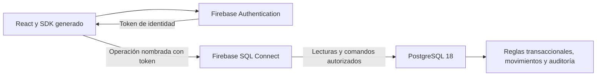

# Arquitectura y validación de NexaTech

React conserva las rutas, los estilos y los flujos de navegación existentes. Firebase Authentication identifica al usuario, SQL Connect expone operaciones GraphQL predefinidas y PostgreSQL aplica las reglas que deben seguir siendo válidas bajo concurrencia. La primera compra verificable se hará localmente con datos sintéticos y pago simulado.

## Límite de confianza y permisos

Firebase Auth gestiona correo de acceso, contraseñas y restablecimiento. El alta de perfil usa el UID autenticado para insertar `AppUser`. La asignación inicial de `CUSTOMER` se realiza en esa misma transacción mediante el disparador de alta. El alta es repetible si Auth creó la cuenta y la primera sincronización SQL falló. El cierre de sesión limpia estado de cuenta. Para personal se exige cuenta identificada con correo verificado. La tabla `UserRole` y el estado activo de `AppUser` aportan la autorización vigente de negocio y permiten revocar accesos sin esperar a que se renueve un token con roles.

| Identidad | Operaciones y controles |
| --- | --- |
| Público | Listar catálogo, ficha, imágenes y reseñas aprobadas. Leer documentos vigentes y FAQ. Proyecciones explícitas con paginación y límites. Se excluyen costos de compra, datos privados y asientos internos de inventario. |
| `CUSTOMER` | Perfil, libreta, carrito, favoritos, cotizaciones, simulación, pedidos, seguimiento, notificaciones y posventa de su cuenta. Los filtros usan `auth.uid` y las escrituras comprueban propiedad incluso al recibir un UUID de recurso. |
| `SUPPORT` | Tomar casos desde una cola con datos mínimos, consultar pedidos necesarios para sus expedientes, gestionar atención y revisión de devoluciones o garantías, registrar evidencia y responder. Sin permisos de ajuste, reembolso, precios ni roles. |
| `ADMIN` | Administrar catálogo, existencias, envíos, usuarios, promociones, reportes, resoluciones financieras y auditoría. Los cambios privilegiados se registran. El primer administrador se aprovisiona desde un proceso autorizado y se conserva al menos uno activo. |

Cada operación de cliente declara `@auth` y liga los datos requeridos a `auth.uid`. En mutaciones privilegiadas, `@check` y `@redact` permiten comprobaciones en el conector. La regla de escritura verifica rol activo y recurso dentro de la transacción. Para reportes y lecturas de personal, las vistas de autorización propuestas incorporan el UID del lector a partir de roles vigentes y, en soporte, el expediente asignado. El conector fija el filtro de lector al UID autenticado y selecciona campos explícitos. Las operaciones internas quedan en `NO_ACCESS` si se requieren para herramientas privilegiadas. Las pruebas negativas deciden si las vistas y filtros cumplen la separación entre roles antes de exponerlos. [Autorización en Firebase SQL Connect](https://firebase.google.com/docs/sql-connect/authorization-and-security)

Las operaciones sensibles reciben parámetros definidos por cada nombre de operación. El servicio nunca recibe un rol como autoridad, un UID de actor, totales de compra, eventos libres ni expresiones SQL del cliente. Los secretos se conservan fuera de Git. La aplicación muestra errores de dominio breves y registra un identificador de correlación sin guardar tokens, contraseñas, datos completos de direcciones ni datos financieros sensibles. Las pruebas cubrirán entradas especiales, UI escapada, límites de cuerpos, abuso de intentos y ausencia de datos privados en logs. App Check se evaluará después de validar Auth y su compatibilidad con el ambiente de demostración.

## Escrituras críticas y compatibilidad

SQL Connect ofrece atomicidad de mutaciones multietapa con `@transaction`. La concurrencia de stock, el límite de cupones y las transiciones con historial necesitan además bloqueos y restricciones de PostgreSQL. Una consulta previa de existencias seguida por una actualización sin condición puede permitir que dos confirmaciones lean el mismo saldo. PostgreSQL ejecutará los cambios completos con bloqueos de fila, actualizaciones condicionadas y constraints. [Mutaciones transaccionales de SQL Connect](https://firebase.google.com/docs/sql-connect/mutations-guide) · [Bloqueos en PostgreSQL 18](https://www.postgresql.org/docs/18/explicit-locking.html)

El primer diseño de integración usa el `_insert` generado de `CommerceCommand` detrás de mutaciones GraphQL nombradas. El conector fija el actor con `auth.uid` y el tipo en cada operación. Un disparador `AFTER INSERT` ejecuta la rutina PostgreSQL de ese tipo y guarda el resultado en la misma transacción. El SDK obtiene la clave del comando y luego consulta su resultado propio tipado o el recurso resultante. Para el carrito se usa el mismo patrón de serialización cuando una escritura afecta la revisión o compite con checkout. Las mutaciones de otros dominios se mantienen acotadas al recurso y pasan por sus reglas de autorización y auditoría.

El índice único de `(actor_uid, idempotency_key)` arbitra reintentos antes de ejecutar el disparador. La inserción estricta rechaza el duplicado. Al recibir ese resultado, la aplicación consulta el comando propio por actor y clave. El conector devuelve la huella que calculó PostgreSQL sobre la operación, la versión y sus entradas normalizadas. El adaptador coteja esa huella con la de su intención original, usando una codificación canónica compartida. Devuelve el resultado anterior si coincide o muestra un conflicto si la misma clave corresponde a otra intención. El índice bloquea cualquier segunda escritura con esa clave, con independencia del cotejo del cliente. Una clave distinta tampoco puede originar un segundo pedido del mismo carrito o cotización. Los errores inesperados revierten toda la transacción. Los rechazos de negocio esperados conservan un código seguro y, donde corresponda, solo un intento de pago. La aplicación mantiene la misma clave mientras desconozca el resultado. Las claves y huellas se conservan durante la ventana documentada de reintentos y los comandos referenciados perduran con su historial.

La fase local debe comprobar que el compilador admite las firmas, que la cuenta de ejecución puede insertar el comando y que las reglas reciben el UID correcto, devuelven un resultado recuperable y conservan su comportamiento tras un diff. Las funciones tendrán nombres calificados, privilegios mínimos, un esquema controlado y entradas tipadas. Se comprobarán los permisos del rol de SQL Connect, los del propietario de migraciones y el acceso al comando y a sus tablas internas. Si se requiere `SECURITY DEFINER` se fijará un `search_path` seguro y se revocará el acceso público de ejecución.

La documentación vigente describe SQL nativo en conectores como Preview. El camino principal usa mutaciones GraphQL predefinidas más reglas en PostgreSQL. Si las pruebas muestran una limitación insalvable del conector o de los privilegios, un backend local puede verificar tokens Firebase con el Admin SDK y llamar las mismas rutinas con un rol dedicado. Su despliegue remoto y el impacto de facturación se decidirían de forma independiente. [SQL nativo en SQL Connect](https://firebase.google.com/docs/sql-connect/native-sql) · [Disparadores PostgreSQL](https://www.postgresql.org/docs/18/sql-createtrigger.html)

## Reglas de compra e inventario

1. **Carrito e identificación.** Visitantes pueden llenar un carrito local con SKU o ID de variante y cantidad. Para comprar se autentican. Una fusión explícita y repetible acepta solo variantes reconocidas, vuelve a comprobar cantidades y catálogo y aumenta la revisión. Las claves heredadas se traducen con el mapa del catálogo. Se avisa sobre artículos no reconocidos, cambios de precio y cantidades ajustadas. El carrito de invitados no contiene credenciales, dirección ni datos de pago.
2. **Cotización.** El servidor lee carrito activo, domicilio propio, variantes vendibles, tarifa de entrega, tasas, cupón y versiones de documentos. Comprueba disponibilidad y cobertura y devuelve resumen y vencimiento. La huella captura los términos de la oferta, la revisión y el resultado de disponibilidad para la cantidad solicitada. Al confirmar se recalcula. Cambios de precio, descuento, domicilio, impuestos, cobertura, plazo o documentos requieren una cotización nueva y revisión del comprador.
3. **Importes.** Calcular `bruto_i = cantidad_i × precio_i`. Prorratear el descuento de cupón por bruto de línea, distribuir centavos residuales por resto mayor con desempate estable por SKU y acotar cada descuento al bruto. Evaluar el umbral de envío gratis sobre el neto de artículos antes de impuestos. Aplicar impuestos configurados al neto de línea y al envío con redondeo comercial explícito al centavo. Usar intermedios enteros o `numeric` exactos cuando multipliquen tasas y convertir a `bigint` bajo límites validados. El total es subtotal menos descuentos más impuestos de artículos, envío e impuesto de envío. Una compra con total cero pasa por la misma confirmación con pago simulado de cero centavos. La política de envío y el precio mostrado al consumidor se revisan con el cálculo fiscal configurado antes de publicar. Los ejemplos y tasas de evaluación se etiquetan como académicos.
4. **Bloqueo y validación.** Todas las escrituras de carrito bloquean su cabecera. Confirmación bloquea el carrito y, si existe, el cupón, y toma las variantes en orden estable de PK. Relee cantidades y condiciones con esos bloqueos. Los ajustes de inventario usan el mismo orden para múltiples variantes. Las tasas, tarifas y políticas consultadas se leen de manera coherente con la cotización, usando bloqueos compartidos o una serialización comprobada con las escrituras administrativas. Los cupos de cupón se cuentan bajo el bloqueo de su fila. Cualquier reintento por serialización o interbloqueo conserva la clave idempotente.
5. **Pago y confirmación.** El simulador del servidor ofrece escenarios sintéticos y nunca pide PAN, CVV ni credenciales financieras. Los intentos pendientes o rechazados no descuentan stock ni convierten el carrito. El intento pendiente expone una acción simulada de resolución propiedad de la cuenta, con su propia clave y revalidación de cotización y aceptación. Si caduca o cambia la compra, termina con un estado de no aprobación y requiere cotizar de nuevo. Un intento aprobado crea folio único con secuencia o identificador de servidor y restricción UQ. Graba el pedido, las partidas, el domicilio, el importe de pago, el envío previsto, la evidencia de términos, el canje, el estado inicial y la notificación. El comprobante es una confirmación académica emitida tras el commit.
6. **Existencias.** Una actualización condicionada por `stock_on_hand >= cantidad` reduce el saldo de cada variante y comprueba la cantidad de filas afectadas. Si una línea falla, la confirmación se revierte. Se escribe un movimiento por partida y se marca el carrito convertido en la misma transacción. Apertura, venta, ajuste, reversión, restock de inspección y reposición dejan un movimiento asociado a su origen. Se reconcilia regularmente el saldo con los movimientos desde la apertura. `CHECK (stock_on_hand >= 0)` protege la columna en todas las rutas.
7. **Aceptación y datos históricos.** Antes de enviar, el cliente ve importe, entrega, aviso y las versiones aplicables. La aceptación de términos usa una casilla inicialmente desmarcada y la fecha/hora del servidor. La copia de compra es inmutable ante cambios del catálogo y de la libreta de direcciones. La consulta administrativa parte de las tablas históricas y los filtros por rol.

## Estados, devoluciones y operación

| Entidad | Transiciones iniciales y reglas |
| --- | --- |
| Pedido | `PAID → PREPARING → SHIPPED → DELIVERED`. `PAID` o `PREPARING` pueden pasar a `CANCELLED` antes del despacho por decisión autorizada. Un pedido entregado puede pasar a `REFUNDED` cuando la devolución financiera es completa. Reembolsos parciales dejan el estado operativo y se visualizan mediante el pago y su expediente. Un rechazo de pago queda en `Payment`. |
| Pago | `PENDING → APPROVED/DECLINED`, o decisión inmediata en el simulador. `APPROVED → REFUNDED` al alcanzarse el importe completo aprobado. Rechazos tienen su referencia y motivo de prueba. |
| Envío | `PLANNED → PREPARING → SHIPPED → DELIVERED`; incidencias o intentos fallidos generan eventos. Puede terminar como `RETURNED_TO_SENDER` con su evento o `CANCELLED` antes de despachar. Cada transición logística compatible actualiza el pedido en la misma transacción. |
| Expediente | `SUBMITTED → IN_REVIEW`, con `NEEDS_INFO` reversible hacia revisión. `IN_REVIEW → APPROVED/REJECTED`. Aprobaciones avanzan por `AWAITING_ITEM → RECEIVED → INSPECTED → RESOLVED` cuando procede retorno físico. Cancelación previa al envío y otros casos sin retorno pueden pasar desde `APPROVED` a `RESOLVED` cuando la acción requerida termina. |
| Reembolso | `PENDING → APPROVED/DECLINED` en simulación. Registro por partida y componente de envío. El pago y el pedido reflejan la conciliación final según sus propias reglas. |
| Ticket | `OPEN → IN_PROGRESS → WAITING_CUSTOMER/RESOLVED`. La respuesta puede reabrir trabajo. Se publican folio, fechas y mensajes visibles. |

El proceso de cancelación bloquea el mismo pedido que el despacho. Así, cuando el despacho se registra primero, la solicitud usa el flujo que corresponda a un pedido enviado. Se revierte stock de ventas canceladas antes del despacho una sola vez. En devoluciones físicas, soporte coteja autoría, partida, política y evidencia, pide información o registra motivo de rechazo. La inspección decide qué unidades son vendibles. Reparación, cambio o reposición registran resolución y, si consumen stock de salida, un movimiento adicional. La cantidad solicitada simultáneamente más la ya resuelta se controla por partida, usando un bloqueo sobre las filas de compra involucradas en orden estable.

El reembolso lo ejecuta un administrador. Se bloquean el pago y las partidas y se cotejan montos ya comprometidos o aprobados. Un reembolso parcial por unidad usa su porción exacta del neto más impuestos históricos, con una regla estable de reparto de residuos y un ajuste en la última unidad elegible. El envío solo se devuelve cuando la resolución lo autoriza y su suma acumulada queda acotada a lo cobrado por ese concepto. Toda resolución guarda actor, motivo, fecha, historial y aviso. Los archivos de evidencia solo se entregan mediante una lectura autorizada, con tipo y tamaño validados, y sin mostrarlos como código ejecutable.

## Contratos de operaciones

Los nombres siguientes son el contrato de diseño. Las firmas y respuestas del SDK se estabilizarán al compilar los conectores. Se documentarán con una colección Postman con casos sintéticos, ejemplos de documentos GraphQL y variables, prueba de cabecera de identidad, códigos HTTP observados y errores de dominio. El SDK expone operaciones predefinidas y permite conservar validación tipada para React y su API de navegación. [SDK y operaciones predefinidas](https://firebase.google.com/docs/sql-connect)

| Grupo | Operaciones previstas | Permiso |
| --- | --- | --- |
| `storefront` | `ListCatalog`, `GetProduct`, `ListCategories`, `ListProductReviews`, `GetPublishedPolicies`. Filtros por texto, categoría, rango de precio y disponibilidad. | Público, límite de página y proyección pública. |
| `account` | `EnsureProfile`, `GetMyProfile`, `UpdateMyProfile`, `ListMyAddresses`, `SaveAddress`, `ArchiveAddress`, `ListMyFavorites`, `SetFavorite`, `SubmitReview`. | Sesión y propiedad, con verificación de compra en reseñas. |
| `account` | `GetMyCart`, `MergeCart`, `SetCartItem`, `RemoveCartItem`, `QuoteCheckout`, `ConfirmCheckout`, `ResolveSimulatedPayment`, `GetMyPaymentStatus`, `GetMyCommandResult`, `ListMyOrders`, `GetMyOrder`, `GetMyShipment`, `ListMyNotifications`, `MarkMyNotificationRead`. | Identidad y propiedad. Confirmación recibe cotización, aceptación, escenario simulado y clave de reintento. |
| `account` | `CreateReturnRequest`, `ListMyReturnRequests`, `GetMyReturnRequest`, `UploadReturnEvidence`, `GetReturnEvidence`, `OpenSupportTicket`, `GetMyTickets`, `ReplyToTicket`. | Identidad y titularidad. Cancelación y garantía son tipos de solicitud. |
| `staff` | `ListSupportQueue`, `AssignCase`, `ReviewReturnRequest`, `RecordInspection`, `ReplyToCustomer`. | Soporte o administrador, con alcance de expediente y controles de estado. |
| `staff` | `SaveCategory`, `SaveProduct`, `SaveVariant`, `ArchiveProduct`, `AdjustInventory`, `ListInventoryMovements`, `SaveCoupon`, `ListCustomers`, `ChangeUserRole`, `ListOrders`, `AdvanceOrder`, `RecordShipmentEvent`, `ApproveRefund`, `PublishPolicy`, `ModerateReview`, `GetAdminReports`, `ListAuditEvents`. | Administrador verificado, con comprobación de rol al ejecutar y auditoría de escrituras críticas. |

Reportes iniciales con rango de fechas semiabierto y zona de negocio explícita. Ventas netas se calculan de pagos aprobados o reembolsados menos devoluciones aprobadas. Pedidos por estado se agrupan de `customer_order`. Los más vendidos suman cantidades históricas por variante e indican si el cálculo es bruto o neto de devoluciones. Stock bajo compara saldo con umbral. Devoluciones agrupa por motivo, tipo, resolución y fecha. Cada agregación usa su relación principal o preagrega sus relaciones de uno a muchos antes de combinarlas para evitar conteos duplicados.

## Plan de archivos y ejecución

| Etapa | Archivos y criterio de avance |
| --- | --- |
| C1. Compatibilidad local | `dataconnect/schema/schema.gql`, `dataconnect/dataconnect.yaml`, primer conector con una consulta válida y operación experimental de comando. Declarar `COMPATIBLE` tras revisar el diff local. Usar el binario disponible con un aislamiento de proyecto demo, comprobar la generación y el comportamiento de relaciones, vistas, disparadores y permisos en PostgreSQL 18. |
| C2. Esquema y datos | `dataconnect/migrations/` con baseline versionado a partir del DDL revisado, restricciones complementarias, funciones, vistas y permisos. `dataconnect/seed/` con roles, tarifas/tasas académicas, documentos de prueba, al menos 15 productos, SKUs y movimientos de apertura. Incluir versiones y una tabla de migraciones con checksum si el mecanismo elegido carece de registro. |
| C3. Conectores | Reemplazar `dataconnect/example/` por `dataconnect/storefront/`, `dataconnect/account/` y `dataconnect/staff/`, con `connector.yaml` y operaciones `.gql`. Ajustar `connectorDirs` y generar bajo `src/dataconnect-generated/` con nombres de paquetes distintos si cada conector genera su propio SDK. Documentar si el código generado se versiona o se genera en instalación. |
| D. Pruebas locales | Agregar casos de SQL y E2E en `tests/` y scripts reproducibles en `package.json`. Generar SDK con `firebase dataconnect:sdk:generate`. Ejecutar Auth y SQL Connect con perfil demo. El conjunto de emuladores con PGlite cubre conectores, Auth y SDK. PostgreSQL 18 local con conexiones separadas verifica concurrencia y restauración. Ambos entornos usan el mismo baseline y reglas cuando sean compatibles. |
| E1. Catálogo y cuenta | Inicialización web en `src/lib/firebase.js`, SDK y adaptadores por dominio, `.env.example` público y reglas de Git para credenciales, datos de emulación y salidas. Integrar catálogo y Auth por rutas existentes, arreglar el uso de hooks, preservar URLs de productos antiguos y retirar los mocks del camino activo gradualmente. |
| E2. Compra y operación | Integrar carrito/fusión, cuenta, direcciones, cotización, pago simulado, confirmación y seguimiento. Añadir rutas de personal y posventa con el sistema visual existente. Los datos remotos reemplazan los importes y stock del navegador. |
| F. Manuales | Actualizar `README.md` y ampliar `docs/` con comandos reales, configuración, API, manuales de cliente y personal, seguridad, matriz legal, fichas, licencias, escenarios, resultados y respaldo. Las capturas se obtienen de la aplicación funcionando. |
| Autorización de entorno remoto | Confirmar vigencia de la prueba y reconsultar metadatos. Revisar plan de migración compatible, destino, permisos y respaldo. Solicitar autorización explícita para crear únicamente `fdcdb` en la instancia existente si sigue ausente, vincular SQL Connect, habilitar Auth o desplegar. |

Las migraciones complementarias se aplicarán por un mecanismo PostgreSQL trazable después del baseline y antes de habilitar conectores de escritura. Se usará un único orden de ejecución reproducible. Las revisiones de diff y los catálogos `pg_constraint`, `pg_indexes` y `pg_trigger` evidenciarán que las restricciones explícitas, las acciones de FK y los disparadores sobreviven a cambios posteriores. Aun en modo compatible, se revisará el DDL concreto porque SQL Connect puede sugerir cambios de nulabilidad y otros ajustes. [CLI de SQL Connect](https://firebase.google.com/docs/sql-connect/cli-reference) · [Validación de esquemas](https://firebase.google.com/docs/sql-connect/manage-schemas-and-connectors)

La configuración web de Firebase identifica el proyecto y se tratará como configuración pública del cliente. Variables `VITE_` solo para valores públicos. Archivos de cuenta de servicio, tokens, DSN, contraseñas PostgreSQL y valores de respaldo pertenecen al entorno de ejecución correspondiente. El perfil local identifica un proyecto `demo-`, apunta a endpoints de emulación y falla si intenta usar destinos remotos. Las instantáneas y pruebas usan datos ficticios. [Emulador de SQL Connect](https://firebase.google.com/docs/sql-connect/data-connect-emulator-suite)

## Pruebas y evidencia de aceptación

Todos los casos de esta sección están pendientes de ejecución. Cada evidencia registrará ID, versión, precondiciones, datos sintéticos, pasos, esperado, obtenido, estado y enlace al resultado. Los resultados de auditoría ya efectuados figuran en el [diagnóstico](diagnostico-nexatech.md).

| IDs | Casos y resultado exigido |
| --- | --- |
| DB-01 a DB-04 | Compilar relaciones y generar SDK. Rechazar referencias inexistentes, duplicados de SKU y folio, campos obligatorios vacíos y restricciones inválidas. Insertar, actualizar, buscar y archivar catálogo con cuenta admin. Comparar diff y catálogos PostgreSQL para comprobar integridad. |
| AUTH-01 a AUTH-04 | Alta, sincronización tras fallo parcial, inicio, cierre y recuperación de prueba. Denegar token anónimo, expirado y sin rol en operaciones de personal. Confirmar que un cliente no adquiere rol propio ni accede a direcciones, pedidos, resultados de comandos, casos o evidencias de otra cuenta. Revocar rol y comprobar denegación con sesión abierta. |
| CART-01 a CART-03 | Altas, cambios, eliminación y fusión heredada idempotente. Validar límite, catálogo archivado y dos sesiones del mismo cliente. Una cotización vieja se invalida al cambiar la revisión o una condición relevante. |
| PAY-01 a PAY-04 | Verificar importes con centavos, prorrateo, impuestos, umbrales de entrega y compra con total cero. Probar aprobado, pendiente válido o caducado y rechazado. Los montos de navegador se ignoran o generan rechazo de validación. Errores inyectados entre pedido y movimiento revierten toda la escritura. |
| TX-01 a TX-04 | Dos conexiones PostgreSQL solicitan la última unidad. Exactamente una confirma y hay un movimiento. Repetir una misma clave de forma concurrente y tras perder respuesta. Debe quedar un pedido, un pago, un canje y un movimiento por partida. Probar claves distintas sobre el mismo carrito, cambio de intención con una clave y cupón con una plaza restante. |
| POST-01 a POST-04 | Cancelación previa al despacho con devolución completa y restock. Carrera de cancelación contra despacho con un solo desenlace válido. Devolución parcial con inspección y reembolso. Garantía rechazada, reparada o repuesta con evidencia y eventos. Probar dos solicitudes que excedan la cantidad comprada y dos reembolsos que excedan el cobro. |
| ADMIN-01 a ADMIN-03 | Consultar pedido confirmado, cambiar estado, registrar guía, visualizar movimientos y verificar vista de reportes sobre importes conocidos. Probar acceso restringido a expedientes, notas internas y auditoría. |
| SEC-01 y SEC-02 | Validación parametrizada, texto con caracteres especiales, campos inesperados, tamaños, evidencia privada, caducidad y revisión de logs. Revisar dependencias, licencias, manejo de credenciales y mensajes de error. |
| E2E-01 y UX-01 | Compra desde búsqueda hasta confirmación, movimiento y consulta administrativa sin tocar SQL. Repetir caso sin existencias y devolución. Revisar dos navegadores, móvil desde 360 px, tableta y escritorio, teclado, contraste, foco, etiquetas y texto alternativo. Cinco tareas observadas con usuarios de prueba. |
| REC-01 | Generar un respaldo de PostgreSQL con `pg_dump -Fc` y restaurarlo con `pg_restore --exit-on-error` en una base desechable. Comparar conteos, sumas, huellas de documentos, stock, folios e historiales. Reejecutar la demostración de lectura y una compra sintética sobre la restauración. |

El ejercicio de continuidad usará respaldo cifrado, almacenamiento con acceso restringido y verificación de integridad. Incluirá versiones de herramientas, tiempos de recuperación observados y prueba de roles, funciones y restricciones en el destino. El entorno de identidad se respalda o reconstruye por separado, con UIDs sintéticos reproducibles o exportación del emulador de Auth. Un cliente restaurado debe poder autenticarse y consultar su pedido con el UID original. La retención y los objetivos RPO/RTO se acuerdan con el responsable antes de incorporar datos reales. La actividad de respaldo en Cloud SQL y sus límites Spark se verifican antes de depender de ella. [pg_dump](https://www.postgresql.org/docs/18/app-pgdump.html) · [pg_restore](https://www.postgresql.org/docs/18/app-pgrestore.html)

## Riesgos y decisiones pendientes

| Decisión o riesgo | Resolución prevista |
| --- | --- |
| Esquema remoto sin origen y `fdcdb` ausente | Avanzar con PostgreSQL y emuladores locales. En remoto se conservará la instancia y el nombre de base propuestos si el estado y el plan autorizados lo permiten. |
| Prueba Spark y capacidad de recuperación | Confirmar fecha de expiración, cuotas y procedimientos cuando se solicite el paso a remoto. Mantener una demo local repetible y respaldos probados. |
| Compatibilidad de SDK, SQL y roles de ejecución | Validar primero una sección mínima que contenga UID, FK, comando y prueba concurrente. Registrar cualquier restricción del servicio y confirmar la alternativa local antes de decidir sobre infraestructura. |
| Datos académicos y reglas comerciales | El diseño parte de compra con cuenta, MXN, una ubicación de stock, un envío por pedido, un cupón por compra y pago simulado. Falta confirmar cobertura, tarifas, umbral, plazo, tasa de prueba, política de canjes, reglas de cancelación y garantía y retención. |
| Evidencia, notificaciones y alcance del panel | La primera versión incluye notificación en cuenta y evidencia pequeña en PostgreSQL. Correo transaccional y almacenamiento separado se evalúan si la demostración o el volumen los requiere. |
| Marco legal y promesas del sitio | Alinear textos de precios, entrega, términos, privacidad, cancelación y garantía con la operación aprobada. Elaborar la matriz de norma, obligación, evidencia, responsable y estado que pide el PDF antes de publicar las políticas definitivas. |
| Deuda de la interfaz | Corregir los hooks reportados por lint, presentación de artículos agotados, identificadores desconocidos y accesibilidad en la integración por etapas, acompañados por regresiones del flujo y de enlaces antiguos. |
