# Modelo relacional de NexaTech

El modelo usa PostgreSQL 18 y conserva las 27 entidades de la propuesta, con ajustes de granularidad y 13 incorporaciones. El catálogo describe productos y vende variantes. Pedidos, pagos, logística y posventa tienen sus propios estados e historiales. Una tienda y un almacén son suficientes para la demostración.

## Convenciones del diccionario

Columnas SQL en `snake_case`. Todos los campos son obligatorios salvo los marcados con `?`. Los identificadores son `uuid` con valor generado por el servidor si no se indica otro tipo. Las claves foráneas usan el tipo de la clave referenciada. Cada entidad incluye `created_at` de tipo `timestamptz` con valor del servidor. Las entidades editables añaden `updated_at`, actualizado por la aplicación de reglas en la base. Todos los registros de eventos usan horas del servidor y se presentan en la zona del negocio.

`txt(n)` indica `text` con un máximo de caracteres validado por SQL. `i32` corresponde a `integer` y `i64` a `bigint`. `cp` es texto de cinco dígitos para conservar ceros iniciales. Los códigos de estados son texto con un conjunto cerrado validado mediante `CHECK`. `¢` indica `i64` de centavos MXN, acotado a un dominio de negocio. `bps` es `i32` de puntos base entre 0 y 10 000, con 100 bps por cada 1 %. La aplicación opera con enteros exactos y transporta `Int64` como cadena donde lo requiera el SDK.

`PK` significa clave primaria, `FK` clave foránea y `UQ` unicidad. `RESTRICT` es la política explícita para referencias comerciales y de seguridad. Se permiten borrados físicos propios de listas y carritos activos donde no se pierdan históricos. El primer SQL debe comprobar la acción real de cada FK, ya que SQL Connect puede generar cascadas por defecto. [Directivas de SQL Connect](https://firebase.google.com/docs/reference/sql-connect/gql/directive#ref_on_field_definition) · [Restricciones de PostgreSQL 18](https://www.postgresql.org/docs/18/ddl-constraints.html)

## Identidad y catálogo

| Entidad y propósito | Campos de diseño y claves | Restricción principal |
| --- | --- | --- |
| `AppUser` / `app_user`, perfil | PK `uid txt(128)` de Firebase Auth, `display_name txt(120)`, `phone txt(25)?`, `status`, `disabled_at?`, `updated_at`. | Auth conserva email de acceso, verificación y credenciales. Estado `ACTIVE/DISABLED`. El correo usado para un pedido se captura en su registro histórico. |
| `Role`, catálogo de permisos | PK `code txt(16)`, `label txt(80)`. | `CUSTOMER`, `ADMIN`, `SUPPORT`. Catálogo controlado por migración. |
| `UserRole`, asignación | PK `(user_uid, role_code)`, ambas FK. `granted_by_uid?` FK a `app_user`. | Asignación automática de `CUSTOMER` al alta. Altas y revocaciones de roles privilegiados dejan un asiento de auditoría. |
| `Address`, libreta | PK `id`, FK `user_uid`, `label txt(48)`, `recipient txt(120)`, `phone txt(25)`, `line1 txt(150)`, `line2 txt(150)?`, `district txt(100)`, `city txt(100)`, `state_code txt(8)`, `postal_code cp`, `country_code txt(2)`, `is_default bool`, `archived_at?`, `updated_at`. | Dirección propia activa, país `MX`, una dirección principal activa por usuario mediante índice único parcial. |
| `Category`, clasificación | PK `id`, UQ `slug txt(120)`, `name txt(120)`, `description txt(1000)?`, `archived_at?`, `updated_at`. | Un producto pertenece a una categoría. El slug es canónico y estable. |
| `TaxClass`, configuración fiscal | PK `code txt(32)`, `label txt(80)`, `rate_bps bps`, `updated_at`. | Tasa aprobada para la demostración y sellada en pedido. Puede definir clases distintas para productos y envío. |
| `Product`, ficha | PK `id`, FK `category_id`, UQ `slug txt(160)`, UQ `legacy_id i32?`, `name txt(160)`, `description txt(6000)`, `specs jsonb?`, `status`, `featured bool`, `archived_at?`, `updated_at`. | `DRAFT/ACTIVE/ARCHIVED`. Las especificaciones de presentación pueden ser flexibles. Los campos usados en filtros tienen columnas tipadas. |
| `ProductImage`, galería | PK `id`, FK `product_id`, `src txt(1024)`, `alt txt(250)`, `position i32`, `credit txt(250)?`. | UQ `(product_id, position)`, `position >= 0`, texto alternativo, origen aprobado e imágenes con licencia documentada. |
| `ProductVariant`, unidad comercial | PK `id`, FK `product_id, tax_class_code`, UQ `sku txt(64)`, `option_label txt(120)`, `color txt(60)?`, `unit_price_cents ¢`, `compare_at_cents ¢?`, `unit_cost_cents ¢?`, `stock_on_hand i32`, `low_stock_threshold i32`, `weight_g i32?`, `length_mm i32?`, `width_mm i32?`, `height_mm i32?`, `archived_at?`, `updated_at`. | Una variante como mínimo para vender un producto, incluso si tiene acabado único. SKU normalizado y sin reutilización. UQ `(product_id, option_label)`. Existencias, precios, umbral y costos no negativos, medidas positivas según aplique. El precio de referencia, cuando exista, debe ser superior al vigente. |
| `Review`, opinión moderada | PK `id`, FK `author_uid, product_id`, FK UQ `order_item_id`, `rating i32`, `body txt(2000)?`, `moderation_status`, FK `moderated_by_uid?`, `moderated_at?`, `updated_at`. | UQ `(author_uid, product_id)`, puntuación de 1 a 5. Autor y producto deben cotejarse con una partida comprada y entregada. Solo reseñas aprobadas en catálogo. |
| `Favorite`, favorito | PK `(user_uid, product_id)`, ambas FK. | Un favorito por usuario y producto. |

La semilla propuesta conserva las seis fichas y las seis categorías visibles hoy. Agrega cuatro fichas a cada categoría evaluada, Computadoras, Audio y Smartphones, para ofrecer 15 productos en esas tres categorías y 18 en total. Cada ficha tiene SKU vendible, descripción, imagen con origen y movimiento de apertura. El campo opcional `legacy_id` mantiene navegables los enlaces actuales y permite traducir IDs de favoritos y carrito previos mediante un mapa explícito de variantes.

## Carrito, compra y logística

| Entidad y propósito | Campos de diseño y claves | Restricción principal |
| --- | --- | --- |
| `Cart`, selección persistente | PK `id`, FK `user_uid`, `status`, `revision i64`, `updated_at`. | `ACTIVE/CONVERTED/ABANDONED`. UQ parcial de carrito activo por usuario. Las modificaciones aumentan la revisión de forma atómica. |
| `CartItem`, línea de carrito | PK `(cart_id, variant_id)`, ambas FK, `quantity i32`, `updated_at`. | Cantidad positiva y acotada. Un carrito no reserva stock y siempre lee el precio vigente. |
| `DeliveryZone`, cobertura | PK `id`, `country_code txt(2)`, `state_code txt(8)`, `label txt(100)`, `active bool`, `updated_at`. | UQ `(country_code, state_code)`. La cobertura inicial se decide por estado. Reglas de CP pueden añadirse si la política requiere exclusiones subestatales. |
| `DeliveryMethod`, medio de entrega | PK `code txt(32)`, `label txt(100)`, `active bool`, `updated_at`. | Paquetería de prueba como método inicial. Los códigos son estables. |
| `DeliveryRate`, tarifa aplicable | PK `(zone_id, method_code)`, ambas FK, FK `tax_class_code`, `price_cents ¢`, `free_threshold_cents ¢?`, `eta_min_days i32`, `eta_max_days i32`, `active bool`, `updated_at`. | Tarifa vigente por zona y método. Rangos de días coherentes, umbral positivo si existe y costo no negativo. |
| `CheckoutQuote`, cotización temporal | PK `id`, FK `cart_id, address_id`, FK compuesta `(zone_id, method_code)` a la tarifa, FK `coupon_id?`, `cart_revision i64`, `pricing_digest txt(64)`, `expires_at timestamptz`. | Se emite en servidor. La huella cubre líneas, disponibilidad, datos de entrega, costos, cupón y documentos vigentes. El domicilio debe pertenecer al comprador. |
| `CustomerOrder` / `customer_order`, pedido | PK `id`, FK `user_uid, cart_id, quote_id`, UQ `folio txt(32)`, UQ `cart_id`, UQ `quote_id`, `status`, `currency txt(3)`, `contact_email txt(254)`, `subtotal_cents ¢`, `discount_cents ¢`, `items_tax_cents ¢`, `shipping_cents ¢`, `shipping_tax_cents ¢`, `shipping_tax_bps bps`, `total_cents ¢`, `confirmed_at timestamptz`, `updated_at`. | `currency = MXN`. Totales con suma exacta y descuento acotado por subtotal. El pedido se crea al aprobar el pago simulado. El propietario del pedido debe coincidir con el del carrito y su cotización. |
| `OrderAddress`, dirección histórica | PK y FK `order_id`, `recipient txt(120)`, `phone txt(25)`, `line1 txt(150)`, `line2 txt(150)?`, `district txt(100)`, `city txt(100)`, `state_code txt(8)`, `postal_code cp`, `country_code txt(2)`. | Una copia inmutable de los datos de entrega efectivos. El cambio o archivo de la libreta no modifica el histórico. |
| `OrderItem`, partidas históricas | PK `id`, FK `order_id, variant_id`, `sku_snapshot txt(64)`, `name_snapshot txt(160)`, `option_snapshot txt(120)`, `description_snapshot txt(6000)`, `quantity i32`, `unit_price_cents ¢`, `discount_cents ¢`, `tax_bps bps`, `tax_cents ¢`. | UQ `(order_id, variant_id)`. Cantidad positiva y descuento dentro del importe bruto. El importe neto de la partida se deriva de sus componentes históricos. |
| `OrderStatusEvent`, historial de pedido | PK `id`, FK `order_id, command_id`, `previous_status?`, `new_status`, `reason txt(600)?`. | Registra alta y cambios mediante la misma transacción que el estado actual. El actor se obtiene del comando. |
| `Payment`, intento simulado | PK `id`, FK `quote_id, order_id?`, FK UQ `checkout_command_id`, UQ `provider_reference txt(100)`, `provider txt(32)`, `status`, `amount_cents ¢`, `terms_accepted_at timestamptz`, `decision_code?`, `decided_at?`, `updated_at`. | `SIMULATED`, importe no negativo y referencia sintética. `PENDING/APPROVED/DECLINED/REFUNDED`. Solo los aprobados/reembolsados tienen pedido, con UQ de `order_id` cuando existe. El resultado asociado al pedido conserva la cotización y la aceptación originales. |
| `Shipment`, despacho | PK `id`, FK UQ `order_id`, `method_snapshot txt(100)`, `carrier txt(100)?`, `tracking_code txt(100)?`, `estimated_from date`, `estimated_to date`, `status`, `shipped_at?`, `delivered_at?`, `updated_at`. | Un envío por pedido confirmado, creado con el método y plazo cotizados. UQ parcial `(carrier, tracking_code)` y ambos presentes al despachar por paquetería. |
| `ShipmentEvent`, seguimiento | PK `id`, FK `shipment_id, command_id`, `event_type`, `public_detail txt(500)?`, `occurred_at timestamptz`. | Incluye despacho, entrega, incidencia, intento fallido y retorno al remitente. Se expone al propietario la proyección para seguimiento. |

## Inventario, promociones y posventa

| Entidad y propósito | Campos de diseño y claves | Restricción principal |
| --- | --- | --- |
| `InventoryMovement`, diario de inventario | PK `id`, FK `variant_id`, FK `command_id?, order_item_id?, return_item_id?`, `kind`, `delta i32`, `reason txt(480)`. | El saldo vive en la variante. El diario es inmutable. `delta <> 0`, signo por tipo, una salida de venta por partida. El vínculo a partida o devolución es obligatorio según el tipo. El comando puede omitirse en aperturas de la semilla trazadas por migración. |
| `Coupon`, regla de promoción | PK `id`, UQ `code txt(48)`, `kind`, `fixed_amount_cents ¢?`, `percentage_bps bps?`, `min_subtotal_cents ¢`, `starts_at timestamptz`, `ends_at timestamptz`, `total_limit i32?`, `per_user_limit i32?`, `archived_at?`, `updated_at`. | Código canónico. Exactamente un valor según el tipo, exclusivo final de vigencia, límites positivos. Un cupón por pedido y reglas de aplicación para todo el carrito. |
| `CouponRedemption`, canje histórico | PK y FK `order_id`, FK `coupon_id`, `code_snapshot txt(48)`. | Un canje por pedido, con usuario e importe obtenidos del pedido. El ejemplo académico cuenta los canjes aprobados incluso si después hay reembolso. |
| `ReturnRequest`, expediente de posventa | PK `id`, FK `order_id`, UQ `folio txt(32)`, FK `assigned_to_uid?`, `kind`, `reason_code`, `description txt(2000)`, `status`, `resolution_code?`, `resolution_note txt(2000)?`, `closed_at?`, `updated_at`. | Tipos `CANCELLATION/RETURN/EXCHANGE/WARRANTY`. Propietario derivado del pedido. La cancelación opera sobre el pedido completo elegible. |
| `ReturnItem`, partida reclamada | PK `id`, FK `return_request_id, order_item_id`, `requested_qty i32`, `approved_qty i32?`, `received_qty i32`, `restocked_qty i32`, `condition_code?`, `inspection_note txt(1000)?`, `updated_at`. | UQ `(return_request_id, order_item_id)`. La partida debe pertenecer al pedido. La suma de unidades comprometidas entre expedientes se controla con bloqueo. Solo ingresan como vendibles las unidades autorizadas e inspeccionadas o revertidas antes del despacho. |
| `ReturnEvent`, historial de expediente | PK `id`, FK `return_request_id, command_id`, `previous_status?`, `new_status`, `public_detail txt(1000)?`. | Cambios inmutables con motivo visible al solicitante cuando corresponda. |
| `ReturnEvidence`, evidencia privada | PK `id`, FK `return_request_id, uploaded_by_uid`, `media_type txt(40)`, `content_b64 txt(349528)?`, `size_bytes i32`, `sha256 txt(64)`, `deleted_at?`, `updated_at`. | UQ `(return_request_id, sha256)`. Evidencia académica pequeña y privada. El contenido y permiso se validan en servidor, con tope propuesto de 256 KiB por archivo y cupo por caso. `deleted_at` solo se registra al retirar el contenido de forma controlada y conservar el evento. |
| `Refund`, devolución financiera | PK `id`, FK `payment_id, return_request_id, command_id`, UQ `provider_reference txt(100)`, `status`, `amount_cents ¢`, `shipping_refund_cents ¢`, `decided_at?`, `updated_at`. | Pago y solicitud pertenecen al mismo pedido. Importe positivo, parcial o total, con envío ya incluido cuando corresponda. Conciliación acumulada bajo bloqueo del pago. |
| `RefundItem`, asignación por partida | PK `(refund_id, return_item_id)`, ambas FK, `amount_cents ¢`. | Solo partidas del expediente asociado al reembolso. Suma por partida más envío igual al monto del reembolso. |
| `SupportTicket`, folio de atención | PK `id`, FK `requester_uid, order_id?, assigned_to_uid?`, UQ `folio txt(32)`, `subject txt(180)`, `status`, `closed_at?`, `updated_at`. | El pedido adjunto debe ser propio. El equipo de soporte accede al expediente asignado o a una cola con datos mínimos. |
| `SupportMessage`, conversación | PK `id`, FK `ticket_id, author_uid`, `body txt(2500)`, `visibility`. | Inmutable. `CUSTOMER_VISIBLE/STAFF_ONLY`. El cliente solo escribe y lee mensajes visibles de sus tickets. |
| `Notification`, aviso en cuenta | PK `id`, FK `user_uid, command_id`, FK `order_id?, return_request_id?, support_ticket_id?`, `kind`, `read_at?`. | Un único recurso de destino por aviso y propietario coherente con el recurso. UQ `(command_id, user_uid, kind)` con avisos emitidos en la transición correspondiente. |

## Seguridad, idempotencia y evidencia legal

| Entidad y propósito | Campos de diseño y claves | Restricción principal |
| --- | --- | --- |
| `CommerceCommand`, solicitud idempotente | PK `id`, UQ `(actor_uid, idempotency_key)`, FK `actor_uid`, `idempotency_key uuid`, `kind`, `input_version i32`, `input_digest txt(64)`, `input jsonb?`, `status`, `result_code txt(48)?`, `result_id uuid?`, `completed_at?`. | Clase de operación fija en el conector. Los datos admitidos están tipados y acotados. El servidor genera huella, resultado y estado. La entrada transitoria se limpia al finalizar. Solo se expone al actor una proyección de resultado. |
| `AuditLog`, bitácora técnica | PK `id`, FK `actor_uid?, command_id?`, `action txt(64)`, `entity_type txt(48)`, `entity_key txt(180)`, `metadata jsonb?`. | Solo inserción para el rol de ejecución. Datos mínimos. Actor opcional para apertura, mantenimiento u otra acción de sistema con origen identificable. |
| `LegalDocument`, versión publicada | PK `id`, `kind`, `version i32`, `title txt(150)`, `body text`, `sha256 txt(64)`, `published_at?`, `withdrawn_at?`. | UQ `(kind, version)` y UQ parcial del documento vigente por tipo. El contenido publicado es inmutable. Tipos de términos, privacidad, envío, cancelaciones, devolución y garantía. |
| `TermsAcceptance`, constancia por compra | PK `(order_id, legal_document_id)`, ambas FK, `evidence_kind` y `presented_at timestamptz`. | Tipos `ACCEPTED/PRESENTED`. Los términos requieren acción afirmativa. El aviso de privacidad y las políticas se registran como presentados. El comprador se obtiene del pedido. El cierre exige exactamente una versión de cada documento marcado como requerido. |

Los 13 complementos a la propuesta distinguen la solicitud idempotente y la cotización, tarifas y tasas, fotografía de domicilio, eventos de pedido y envío, evidencia e historial de devoluciones, asignación de reembolsos y aviso al cliente. `User` y `Order` se representan como `AppUser` y `CustomerOrder` para usar nombres claros en PostgreSQL. El dato de credenciales queda en Firebase Auth. El stock comercial está en la variante y el costo de entrega facturado en el pedido.

## Diagrama entidad-relación

```mermaid
erDiagram
    APP_USER ||--o{ USER_ROLE : tiene
    ROLE ||--o{ USER_ROLE : asigna
    APP_USER ||--o{ ADDRESS : guarda
    APP_USER ||--o{ CART : usa
    APP_USER ||--o{ REVIEW : escribe
    APP_USER ||--o{ FAVORITE : guarda
    CATEGORY ||--o{ PRODUCT : clasifica
    PRODUCT ||--o{ PRODUCT_IMAGE : muestra
    PRODUCT ||--o{ PRODUCT_VARIANT : ofrece
    PRODUCT ||--o{ REVIEW : recibe
    PRODUCT ||--o{ FAVORITE : recibe
    TAX_CLASS ||--o{ PRODUCT_VARIANT : grava
    TAX_CLASS ||--o{ DELIVERY_RATE : grava
    CART ||--o{ CART_ITEM : contiene
    PRODUCT_VARIANT ||--o{ CART_ITEM : seleccionada
    CART ||--o{ CHECKOUT_QUOTE : cotiza
    ADDRESS ||--o{ CHECKOUT_QUOTE : entrega
    DELIVERY_ZONE ||--o{ DELIVERY_RATE : aplica
    DELIVERY_METHOD ||--o{ DELIVERY_RATE : tarifa
    DELIVERY_RATE ||--o{ CHECKOUT_QUOTE : valora
    COUPON o|--o{ CHECKOUT_QUOTE : aplica
    CART ||--o| CUSTOMER_ORDER : origina
    CHECKOUT_QUOTE ||--o| CUSTOMER_ORDER : confirma
    APP_USER ||--o{ CUSTOMER_ORDER : compra
    CUSTOMER_ORDER ||--|| ORDER_ADDRESS : conserva
    CUSTOMER_ORDER ||--|{ ORDER_ITEM : contiene
    PRODUCT_VARIANT ||--o{ ORDER_ITEM : vendida
    ORDER_ITEM ||--o| REVIEW : acredita
    CUSTOMER_ORDER ||--|{ ORDER_STATUS_EVENT : registra
    CUSTOMER_ORDER o|--o| PAYMENT : concilia
    CUSTOMER_ORDER ||--|| SHIPMENT : prepara
    SHIPMENT ||--o{ SHIPMENT_EVENT : registra
    PRODUCT_VARIANT ||--o{ INVENTORY_MOVEMENT : mueve
    ORDER_ITEM o|--o{ INVENTORY_MOVEMENT : origina
    RETURN_ITEM o|--o{ INVENTORY_MOVEMENT : revierte
    COUPON ||--o{ COUPON_REDEMPTION : canjea
    CUSTOMER_ORDER ||--o| COUPON_REDEMPTION : aplica
    CUSTOMER_ORDER ||--o{ RETURN_REQUEST : reclama
    RETURN_REQUEST ||--|{ RETURN_ITEM : agrupa
    ORDER_ITEM ||--o{ RETURN_ITEM : referencia
    RETURN_REQUEST ||--|{ RETURN_EVENT : registra
    RETURN_REQUEST ||--o{ RETURN_EVIDENCE : adjunta
    PAYMENT ||--o{ REFUND : financia
    RETURN_REQUEST ||--o{ REFUND : resuelve
    REFUND ||--o{ REFUND_ITEM : asigna
    RETURN_ITEM ||--o{ REFUND_ITEM : detalla
    APP_USER ||--o{ SUPPORT_TICKET : solicita
    CUSTOMER_ORDER o|--o{ SUPPORT_TICKET : contextualiza
    SUPPORT_TICKET ||--o{ SUPPORT_MESSAGE : contiene
    APP_USER ||--o{ NOTIFICATION : recibe
    APP_USER ||--o{ COMMERCE_COMMAND : solicita
    COMMERCE_COMMAND ||--o| PAYMENT : origina
    COMMERCE_COMMAND ||--o{ AUDIT_LOG : registra
    COMMERCE_COMMAND ||--o{ ORDER_STATUS_EVENT : causa
    COMMERCE_COMMAND ||--o{ SHIPMENT_EVENT : causa
    COMMERCE_COMMAND o|--o{ INVENTORY_MOVEMENT : causa
    COMMERCE_COMMAND ||--o{ RETURN_EVENT : causa
    COMMERCE_COMMAND ||--o{ REFUND : causa
    COMMERCE_COMMAND ||--o{ NOTIFICATION : causa
    CHECKOUT_QUOTE ||--o{ PAYMENT : valora
    CUSTOMER_ORDER ||--|{ TERMS_ACCEPTANCE : conserva
    LEGAL_DOCUMENT ||--o{ TERMS_ACCEPTANCE : versiona
```

El diccionario precisa las referencias adicionales de actores, responsables y recursos de notificación. Las cardinalidades de pedido confirmado, dirección, envío y constancias se satisfacen en su transacción de creación.

## Índices, consistencia e integridad

| Consulta o garantía | Índice o mecanismo |
| --- | --- |
| Catálogo activo y paginado | B-tree de `product(category_id, status, id)` y `product_variant(product_id, archived_at, unit_price_cents, id)`. Lectura pública de fichas activas con al menos una variante activa. Índice GIN de búsqueda en nombre y descripción solo si el plan real de consultas y el volumen lo justifican. |
| Carrito activo y dirección principal | Únicos parciales en `cart(user_uid) WHERE status = 'ACTIVE'` y `address(user_uid) WHERE is_default AND archived_at IS NULL`. B-tree de `address(user_uid, archived_at, id)`. |
| Accesos y panel | `user_role(role_code,user_uid)` para listas administrativas. PK en orden inverso para verificar roles por usuario. `customer_order(user_uid, created_at DESC, id)` y `customer_order(status, created_at DESC, id)`. |
| Seguimiento y posventa | B-tree sobre `order_id`, `shipment_id`, `return_request_id`, `ticket_id`, respectivamente, seguido de hora e ID en cada historial. `return_request(status, created_at, id)`, `return_item(order_item_id)`, `refund(payment_id, status)`, `notification(user_uid, read_at, created_at)` e índice parcial de expedientes abiertos por asignación. |
| Inventario y conciliación | `inventory_movement(variant_id, created_at DESC, id)`. Índice único parcial `inventory_movement(order_item_id) WHERE kind = 'SALE'`. Índices de referencia para consultas de movimientos por devolución. Stock bajo calculado al consultar mediante umbral. |
| Límites y reintentos | `coupon_redemption(coupon_id, order_id)`, UQ de pedido por carrito y por cotización, UQ de intento por comando, UQ de actor y clave idempotente. `checkout_quote(cart_id, expires_at)` facilita expiración y limpieza según política de retención. |
| Búsqueda en auditoría | `audit_log(entity_type, entity_key, created_at DESC)` y `audit_log(actor_uid, created_at DESC)`. |
| Integridad de referencias | Las PK y las UQ ya proveen sus índices. Se agregan índices para FKs con consultas inversas o validaciones frecuentes que carezcan de un prefijo útil. Orden/partida, solicitud/partida, pago/solicitud, dueño/dirección y clase/resultado se validan mediante FK compuesta donde se pueda y mediante rutina transaccional donde el predicado cruza tablas. |

La nulabilidad, PK, FK, unicidad simple y compuesta, fechas e índices ordinarios se trasladarán a GraphQL con `@table`, tipos no nulos, `@ref`, `@unique`, `@default` y `@index` según el esquema generado. `@check` del conector evalúa resultados de operaciones. Los `CHECK` de dominio de PostgreSQL, índices parciales, restricciones de agregados, inmutabilidad y disparadores se incorporarán como migraciones SQL revisadas. Después de cada cambio se compararán catálogos y comportamiento. [Directivas oficiales](https://firebase.google.com/docs/reference/sql-connect/gql/directive) · [Administración y compatibilidad del esquema](https://firebase.google.com/docs/sql-connect/manage-schemas-and-connectors)

## Normalización y datos históricos

- **1FN.** Un valor por atributo de negocio. Imágenes, variantes, roles, líneas, mensajes y evidencias tienen filas propias. Las especificaciones visuales de una ficha y los metadatos acotados de auditoría y comandos son documentos de presentación o intercambio con claves permitidas. Si una especificación se convierte en criterio de búsqueda o comparación, pasa a un atributo tipado.
- **2FN.** En relaciones compuestas, los datos dependen de la clave completa. `CartItem.quantity` depende del carrito y la variante, y `DeliveryRate.price_cents` de zona y método. Nombres, slugs, precios de catálogo y roles se mantienen en sus respectivas entidades.
- **3FN.** El perfil, la ficha, la tasa, la dirección editable y la regla de cupón tienen una fuente propia. Propietario de devolución, usuario del canje, actor de los eventos y moneda de partidas se obtienen a través de sus relaciones. Calificación promedio, importes de línea, cupos consumidos y reportes se derivan.
- **Excepciones deliberadas.** Dirección, SKU, descripción, precio, tasas, importe de envío y términos describen lo pactado en una fecha. El total de pedido se congela para conciliación y se verifica contra partidas y componentes al escribir. La referencia directa del pedido al carrito, también recuperable desde la cotización, permite imponer un solo pedido por carrito con unicidad en la base. La referencia del pago a la cotización conserva intentos previos al pedido y se verifica al aprobar. Estado actual y eventos se actualizan juntos para lectura operativa. El stock de la variante se actualiza con el diario en la misma transacción para bloqueo y reconciliación. Huella de cotización y referencias de bitácora mantienen evidencia operacional.
